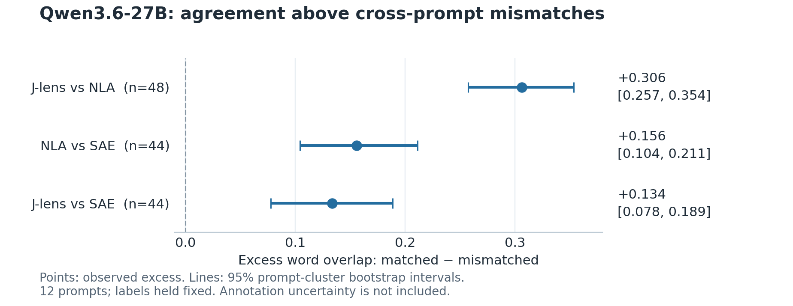

# Do three interpretability methods agree on Qwen3.6-27B?

Exploratory findings · 12 October 2026

## Question

When a Jacobian lens (J-lens), a natural-language autoencoder (NLA), and a sparse autoencoder (SAE) read the same internal activation, do their descriptions agree more than descriptions drawn from different prompts?

We adapted the agreement experiment from [Morgan Hough’s tri-lens study](https://github.com/m9h/tri-lens) to Qwen3.6-27B, retaining its prompts, sampling positions, and lexical overlap metric. This report covers the observational agreement experiment. The causal steering experiment has not been run.

## TL;DR

**All three pairs showed greater agreement on the same activation than on activations from different prompts.** J-lens and NLA showed the largest excess overlap: 0.306. Both SAE comparisons also showed positive excess overlap, although automatic feature labels and incomplete coverage make those findings more provisional.

The evidence is consistent with the methods recovering some shared, readable content from Qwen’s representations. It does not yet establish that their descriptions identify the features responsible for the model’s behavior.

## Results and inference

| Comparison | Activations | Matched overlap | Mismatched overlap | Excess | Descriptive z | Beats every mismatch |
| --- | ---: | ---: | ---: | ---: | ---: | ---: |
| J-lens vs NLA | 48 | 0.329 | 0.023 | +0.306 | 4.43 | 75% |
| NLA vs SAE | 44 | 0.208 | 0.052 | +0.156 | 2.42 | 32% |
| J-lens vs SAE | 44 | 0.143 | 0.009 | +0.134 | 2.79 | 43% |

“Excess” is matched minus mismatched overlap. “Beats every mismatch” requires the correct pairing to beat all 44 cross-prompt alternatives for J-lens–NLA, or 40–42 for the SAE rows. The displayed z expresses excess in mismatch standard deviations; it is not a significance-test statistic.

*Figure 1. Excess agreement and 95% prompt-cluster bootstrap intervals: J-lens–NLA, 0.257–0.354; NLA–SAE, 0.104–0.211; J-lens–SAE, 0.078–0.189. Labels were held fixed, so these intervals omit annotation uncertainty.*

J-lens–NLA beat every cross-prompt alternative for 36 of 48 activations. The SAE results suggest shared content also appears in sparse feature descriptions. Their lower scores cannot rank instrument quality: readouts differ in length and vocabulary, and most selected SAE features lacked accepted labels.

## Methods

**Activations.** We generated deterministic continuations for 12 English prompts using Qwen3.6-27B with thinking disabled and a 150-token generation limit. We saved the residual after zero-based block 42, at absolute token indices 60, 85, 110, and 135 in the complete chat sequence. These indices include the prompt and template tokens; they are not offsets into the generated answer. This produced 48 activations of dimension 5,120.

**Three readouts of each saved vector.** J-lens used the published Qwen3.6-27B Jacobian checkpoint fitted on 1,000 prompts; we mapped each activation through the lens and unembedding, then decoded its top 12 tokens. NLA used the pretrained [Qwen verbalizer](https://huggingface.co/ceselder/qwen3.6-27b-nla-rl), with its step-600 RL adapter attached to the supplied merged warm-start base. We passed the activation through the prescribed norm-matched injection interface, without supplying the evaluation text to the verbalizer. All 48 explanations completed their required format within 256 generated tokens. This injection is the NLA’s readout mechanism; we did not steer the source model.

SAE used the pretrained [2,097,152-feature block-42 checkpoint](https://huggingface.co/ceselder/qwen36-27b-sae2m-l42), with the published centering and learned activation threshold. We selected the eight strongest active features per activation and concatenated their accepted descriptions. **No new SAE or other model was trained.**

**Feature descriptions.** Qwen3-4B-Instruct-2507 proposed labels from published maximum-activation text windows. A document was withheld from label generation; checks required support in a withheld window and no support in a random other-feature window. Labeling and review received no evaluation prompts, J-lens tokens, or NLA explanations. We detected duplicated withheld text across document IDs and excluded 18 otherwise accepted labels before inspecting SAE scores. After a spot check found wording problems, a separate Qwen3.6-27B base-model review screened all 154 remaining labels and retained 88. This was automatic review, not a human audit.

**Scoring and uncertainty.** We retained the original English word-set overlap: common words divided by the smaller set’s size, after stop-word removal and light plural normalization. We compared each matched pair against all ordered cross-prompt pairings, excluding same-prompt pairs from the null. We bootstrapped the 12 prompts 4,000 times, keeping each prompt’s four positions together. Empty normalized word sets scored zero. The primary SAE rows excluded four activations with no accepted labels; counting those as zero still gave positive excesses of 0.142 for NLA–SAE and 0.122 for J-lens–SAE.

**Prompt-word sensitivity.** A post hoc split attributed 79–87% of the original excess to shared words absent from the source activation’s input prompt, using the original denominator and a fixed source-prompt mask across mismatch candidates. We also removed the combined normalized vocabulary of all 12 prompts from both readouts, identically for every pairing, and re-normalized the remaining overlap. Excess remained +0.282 for J-lens–NLA, +0.143 for NLA–SAE, and +0.111 for J-lens–SAE, with prompt-bootstrap intervals above zero. Filtering-induced empty sets stayed in the analysis. [Full split and intervals](artifacts/prompt_overlap_report.md).

## Prompts used — verbatim

These are all 12 evaluation prompts, not a selected subset:

1. “Explain how a volcano erupts and what happens to the surrounding area.”
2. “Explain how a fixed-rate mortgage works and what affects the interest rate.”
3. “Explain the rules of cricket to someone who has never seen a match.”
4. “Describe what happens in a typical opera and why the form endures.”
5. “Explain how glaciers form and how they reshape a landscape.”
6. “Explain how mitochondria produce energy inside a cell.”
7. “Explain how earthquakes happen along tectonic fault lines.”
8. “Explain how a compiler turns source code into a running program.”
9. “Describe how migrating birds navigate over long distances.”
10. “Explain how coral reefs form and why they are bleaching.”
11. “Explain how bread dough rises and what yeast is doing.”
12. “Explain how a vaccine trains the immune system.”

## What remains uncertain

**Coverage and label quality.** Accepted SAE labels covered 44/48 activations, but only 105/384 selected feature slots and 88/272 unique selected features. Automatic review left occasional incorrect terminology or unsupported qualifiers. SAE reconstruction explained variance was 0.601 on these 48 activations; this is a sample diagnostic, not a population estimate. The [SAE publisher also documents repeated training data caused by a loader defect](https://huggingface.co/ceselder/qwen36-27b-sae2m-l42).

**What the control establishes.** Agreement survives literal prompt-word removal, but topic synonyms and continuation structure remain possible explanations. Different-prompt mismatches do not separate broad topic recognition from information specific to an individual token position; within-prompt shuffles would help. Lexical overlap misses paraphrases and can reward generic wording. The instruments and label reviewers share the Qwen model family, so agreement is not evidence from three fully independent systems.

**Scope of the conclusion.** This is a 12-prompt exploratory adaptation. Independent NLA reconstruction checks and validation of the published J-lens’s provenance and readout remain pending. The next useful steps are a human audit of feature labels, a larger prompt set with within-prompt controls, and—after consultation—a steering experiment that checks both generated behavior and instrument reports.

## Reproduction and figures

The local scripts run without the cloned tri-lens directory, while retaining attribution for its protocol and reused metric. Exact checkpoint revisions, run IDs, readouts, and sensitivity analyses are recorded in [the results JSON](artifacts/sae_comparisons.json), [agreement data](artifacts/agreement.json), and [launcher documentation](README.md). The main collection took approximately 35 minutes; SAE encoding, labeling, and review added approximately seven minutes of GPU-stage elapsed time, excluding downloads and queues.

One chart is sufficient for this short report: the excess-agreement plot above makes the effect sizes and uncertainty visible, while the table preserves the measured values. Additional charts can wait for more prompts or causal results. The figure is also available as [PDF](artifacts/agreement_excess.pdf) and [SVG](artifacts/agreement_excess.svg).
